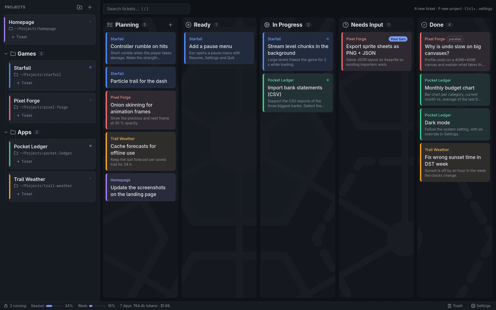
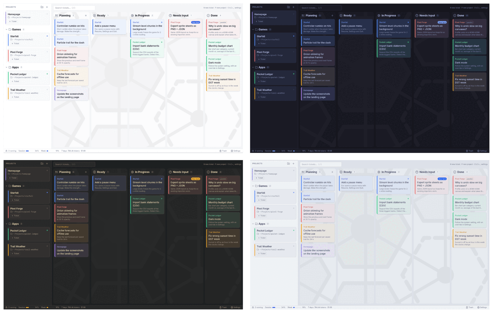

<p align="center">
  
</p>

<h1 align="center">Hivemind</h1>

<p align="center">
  <b>All your AI coding agents on one Kanban board.</b><br>
  Write a ticket, drag it to <i>Ready</i>, and let Claude Code or OpenCode do the work – in as many projects at once as you like.
</p>

<p align="center">
  <a href="https://github.com/BorisBrock/Hivemind/releases/latest"></a>
  <a href="https://github.com/BorisBrock/Hivemind/actions/workflows/ci.yml"></a>
  <a href="https://aur.archlinux.org/packages/hivemind"></a>
  
  <a href="LICENSE"></a>
</p>

<p align="center">
  
</p>

---

## 🐝 Stop juggling terminals

Coding agents are great at working on their own – until you have five of them running in five
terminal tabs and lose track of which one is waiting for an answer. Hivemind turns that into a
board you can see at a glance:

- **📝 Plan** the work as tickets, in plain Markdown, with screenshots pasted right in.
- **🚦 Queue** it: drag a ticket to *Ready* and Hivemind starts the agent in the project folder.
- **💬 Talk** to the agent inside the ticket. Its questions land in *Needs Input*, you answer
  with a click.
- **✅ Review** what it did in the transcript, then close the ticket – or send it back with a
  comment.

One agent per project at a time, any number of projects in parallel.

---

## ✨ Features

### 🗂️ A Kanban board for agents

Tickets move through **Planning → Ready → In Progress → Needs Input → Done**. Hivemind starts
the next *Ready* ticket of a project as soon as the previous one is finished. Group your projects
in the sidebar, search all tickets with `/`, and restore closed tickets from the **Trash**.

### 🤖 Claude Code and OpenCode

Hivemind runs [Claude Code](https://claude.com/claude-code) or [OpenCode](https://opencode.ai)
headless and shows their work as a readable transcript: messages, tool calls, files touched,
results. Pick the agent and model in Settings.

### 🙋 Questions with one-click answers

When an agent needs a decision, the ticket moves to *Needs Input*, Hivemind gets your attention
with a desktop notification, and the question shows up with ready-made answers to pick from – or
type your own.

### 🗣️ Talk to a working agent

"What are you doing right now?" – send a message while the agent is still busy. Claude Code reads
it at its next step; OpenCode gets it as its next turn.

### 🖼️ Screenshots in, previews out

Paste screenshots with `Ctrl+V` into a ticket or a reply; the agent receives them as images.
Files an agent mentions become links, and images (also SVG) show as previews below its message.

### ⚡ Parallel tickets

Questions and analyses that change nothing can run *alongside* the project's queue, so you don't
have to wait for a big feature to finish before asking "Why is undo so slow?".

### 📊 Usage at a glance

The status bar shows how many agents are running, your Claude session and weekly limits, and the
tokens and cost of the last 7 days.

### 🎨 12 themes, 5 colour palettes

<p align="center">
  
</p>

Eight dark and four light themes, and project colour palettes including a colour-blind safe one.

### 🔒 Local and private

No account, no cloud, no telemetry. Tickets and transcripts live in a SQLite database on your
machine; the only thing that talks to the internet is the agent you chose.

> [!WARNING]
> Agents run **fully autonomously**, without permission prompts. They can do anything your user
> account can do, also outside the project folder. Use version control in your projects so you
> can review and undo their changes.

---

## 📦 Installation

Download the latest version from the
**[releases page](https://github.com/BorisBrock/Hivemind/releases/latest)**.

### Windows

Download and run **`Hivemind_<version>_x64-setup.exe`**. It installs for your user only, no admin
rights needed. Prefer no installation? Take **`Hivemind-<version>-windows-x64.exe`** – it runs as
is, from anywhere.

Windows SmartScreen may warn about an unknown publisher: click *More info → Run anyway*.

### Arch Linux, CachyOS, Manjaro (AUR)

Install [`hivemind`](https://aur.archlinux.org/packages/hivemind) with an AUR helper:

```bash
paru -S hivemind     # or: yay -S hivemind
```

The package is built from source, which takes a few minutes the first time.

### Ubuntu, Debian, Linux Mint, Pop!_OS

Download **`Hivemind_<version>_amd64.deb`** and install it:

```bash
sudo apt install ./Hivemind_*_amd64.deb
```

Needs Ubuntu 24.04, Debian 13 or newer.

### Any other Linux (AppImage)

Download **`Hivemind-<version>-linux-x64.AppImage`**, make it executable and run it:

```bash
chmod +x Hivemind-*-linux-x64.AppImage
./Hivemind-*-linux-x64.AppImage
```

---

## 🚀 Getting started

### Requirements

Hivemind drives an agent CLI that you install and sign in to yourself – at least one of:

- **[Claude Code](https://docs.claude.com/en/docs/claude-code/setup)** (`claude`). On Windows,
  Claude Code also needs [Git for Windows](https://git-scm.com).
- **[OpenCode](https://opencode.ai)** (`opencode`) 1.18 or newer.

Hivemind finds them on your `PATH`; otherwise set the path in **Settings**, where **Check** tells
you whether it works.

### Your first ticket

1. Press **`P`** to add a project: a name and the folder of its code.
2. Press **`N`** to write a ticket: what you want done, as precisely as you would tell a colleague.
3. Drag the ticket to **Ready**. The agent starts, and the ticket moves to *In Progress*.
4. Click the ticket to follow along. When it lands in *Needs Input*, answer; when it is *Done*,
   review the changes and close it.

| Key | Action |
|---|---|
| `N` | New ticket |
| `P` | New project |
| `/` or `Ctrl+K` | Search tickets |
| `Ctrl+V` | Paste a screenshot into a ticket or reply |
| `Ctrl+Enter` | Send a reply |
| `Ctrl+,` | Settings |

---

## ☕ Support the project

If Hivemind saves you from terminal-tab chaos, you can buy me a coffee. Thank you!

<a href="https://www.buymeacoffee.com/borisbrock" target="_blank"></a>

---

## 🛠️ For developers

- **[Building from source](docs/BUILDING.md)** – requirements, development setup, local release
  builds, tests and environment variables.
- **[Releasing](docs/RELEASING.md)** – how the CI/CD pipeline builds and publishes Windows, Linux
  and AUR releases.

Hivemind is built with [Tauri 2](https://v2.tauri.app), [Svelte 5](https://svelte.dev) and Rust.

---

## 📄 License

Hivemind is free and open source under the [MIT License](LICENSE).

Hivemind is an independent project and is not affiliated with Anthropic or the OpenCode project.
